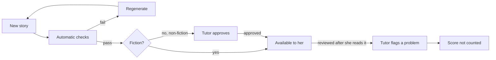

# TutorLumi Adaptive Reading Stories – Spec

Updated Oct 22, 2026. Living version: [TutorLumi Adaptive Reading Stories – Spec](https://claude.ai/artifact/1HSd5S8s7LrEc2YoF5LQgT).

## Overview

TutorLumi will give a dyslexic student short stories matched to her reading level, read them aloud with each word highlighted, and adjust the difficulty after every story based on her quiz score.

Each week the system generates 50 new stories (fiction and non-fiction) across 5 difficulty levels. She reads 2 a day, rates each one, and her ratings shape the following week's stories. Her tutor and parents watch her level over time in a shared progress view.

**Goals**

- Build reading comprehension and decoding at a level that stretches her but where she gets at least half the questions right.
- Move her steadily from a 2nd-grade reading level toward her 5th-grade level.
- Keep her engaged with stories about things she cares about.
- Give the tutor and parents a clear, honest picture of her progress.

## Student profile

| | |
| --- | --- |
| Grade | 5th grade (age about 10–11) |
| Reading level | About 2nd grade |
| Needs | Dyslexia: read-aloud support, dyslexia-friendly layout |
| Location | Washington State |
| Interests | Miniatures, creature-collecting games (Pokémon-style), horses, art and drawing |

The stories must be **high-interest, low-readability**: simple enough words and sentences for her reading level, but topics, characters and plots that suit a 10–11 year old. Nothing that feels babyish.

**Built for more students.** TutorLumi will serve other students later, so placement, level, interests, ratings and the progress view are kept per student from the start. A tutor can manage several students; parents see only their own child.

## Reading levels

The 5 levels run from early 2nd grade to 5th grade, her own grade. They start below her current level so she has room to succeed, and Level 5 is the goal.

They follow Washington's reading standards. Washington uses the 2011 Common Core standards in 2026–27 and switches to revised standards in 2027–28. The revised standards put more weight on foundational skills (phonics, decoding) and align with structured literacy, the explicit phonics teaching recommended for dyslexia.

| Level | Grade target | Length | Words and sentences | Question focus | Standards |
| --- | --- | --- | --- | --- | --- |
| 1 | Early 2nd | 100–150 words | Short sentences; mostly one-syllable words with short and long vowels | Who, what, where, when | RL/RI.2.1, RF.2.3 |
| 2 | Late 2nd | 150–250 words | Some two-syllable words; common prefixes and suffixes (un-, re-, -ed, -ing, -ful) | Why and how; order of events; how a character reacts | RL/RI.2.1–2.3, RF.2.3 |
| 3 | 3rd | 250–350 words | Longer words; more suffixes; some irregular spellings | Character feelings and reasons; the lesson; word meaning from context | RL/RI.3.1–3.4, RF.3.3 |
| 4 | 4th | 350–450 words | Multi-syllable words; varied sentence structure | Inferences backed by details; theme; main idea | RL/RI.4.1–4.3, RF.4.3 |
| 5 | 5th (goal) | 450–600 words | Multi-syllable words with common Greek and Latin roots; some figurative language | Quoting the text as evidence; comparing characters; theme; figurative language | RL/RI.5.1–5.4, RF.5.3 |

Word counts and spelling patterns per level are our working targets, not numbers from the standards. The tutor can adjust them. Before finalizing the content rules, check the revised 2026 standards document for any grade-level changes.

## Placement test

On her first session, a short adaptive test finds her starting level: the highest level where she gets at least half the questions right.

1. She reads a Level 2 passage (one fiction, one non-fiction) **with read-aloud turned off** and answers 4 questions on each, 8 in total.
2. 6–8 correct: try the next level up. 4–5 correct: that is her level. 0–3 correct: try the level below.
3. If she moves up and then gets 0–3 correct, her level is the one below. The test stops when she settles on a level or reaches Level 1 or Level 5, after at most 4 rounds.
4. Optional second pass: repeat her placement-level passage with read-aloud on. The gap between the two scores shows how much decoding holds her back compared with understanding. Many dyslexic children understand far more by ear.

Placement passages are a fixed set, reviewed by the tutor once, not regenerated each week. The tutor can re-run the test at any time and can set her level by hand.

## Weekly content cycle

Every week the system generates 50 stories: for each of the 5 school days, 1 fiction and 1 non-fiction story at each of the 5 levels.

| | Level 1 | Level 2 | Level 3 | Level 4 | Level 5 |
| --- | --- | --- | --- | --- | --- |
| Each day | 1 fiction + 1 non-fiction | 1 fiction + 1 non-fiction | 1 fiction + 1 non-fiction | 1 fiction + 1 non-fiction | 1 fiction + 1 non-fiction |
| Each week (5 days) | 10 | 10 | 10 | 10 | 10 |

She reads 10 of the 50 each week. Having both a fiction and a non-fiction story at every level, every day, means she always has a fresh story whatever her level, including two at the same level on the same day. The unused 40 are archived and can be served later if she runs out at a level.

**Topics**

- Built around her interests: miniatures, horses, art and drawing, and original creature-collecting adventures in the spirit of Pokémon. No Pokémon names, characters or places.
- Combine interests where it works: a girl painting a miniature horse for a contest, a drawing that comes to life, a tiny museum of model creatures.
- Non-fiction stays on the same themes: how horses communicate, how artists mix colors, how miniatures are made.
- About 1 in 8 stories tries a new topic, so her ratings can uncover interests we don't know yet.
- From week 2 on, topics are weighted by her ratings (see Student feedback).

**Timing:** stories for the coming week are generated by the weekend before, so the tutor has time to approve the non-fiction before Monday.

## Story and question rules

Every story follows its level's limits from the Reading levels table and comes with 4 multiple-choice questions.

**Stories**

- A clear title and short paragraphs (2–4 sentences each).
- Characters and situations a 10–11 year old relates to; kind, safe, no scary or upsetting content.
- Non-fiction uses only simple, widely known facts.
- Each story is tagged with its level, fiction or non-fiction, topic(s), word count, and the spelling patterns it practices.

**Questions**

- 4 questions per story, asked one at a time.
- 3 answer choices each (fewer choices means less reading load for her).
- Exactly one correct answer, and it must be supported by the story text.
- Wrong choices are believable but clearly wrong once she checks the story. No trick questions.
- Each question is tagged with its type: *detail*, *sequence*, *character*, *vocabulary*, *main idea/lesson*, or *inference*. The mix follows the level's question focus.
- The story stays on screen while she answers. We are testing understanding, not memory.

**Scoring**

Each question is worth 1 point, so a story scores 0–4 (0%, 25%, 50%, 75% or 100%).

## Review and release

Fiction is available to her as soon as it passes automatic checks. Non-fiction also has to be approved by the tutor first, because AI-written facts can be wrong.

**Automatic checks (every story, before release)**

- Content is safe and suitable for a 10–11 year old.
- Length, sentence length and word difficulty fit the story's level.
- Each question has exactly one correct answer, and the story supports it.
- A story that fails is regenerated automatically. The tutor never sees it.

**Tutor review screen**

- Shows each story with its level, type, topic, questions and answer key.
- If she has already read it: her score, her answers and her rating.
- Actions: **Approve**, **Edit** (fix wording, a question or the answer key), **Flag** (with a reason: wrong answer key, confusing question, wrong level, inappropriate).
- Non-fiction waiting for approval is listed first.

**When a story is flagged after she read it**

- Her score on that story no longer counts toward her level, so one bad question can't move her down.
- A story flagged as inappropriate is removed from her library.
- Flag reasons feed back into generation, so the same mistakes are less likely next week.

**If non-fiction isn't approved in time:** she gets an extra fiction story at her level instead. Her session never stalls waiting for the tutor.

## Daily session and level changes

She reads 2 stories a day, one fiction and one non-fiction, and her level can change after each one.

**Session flow**

1. She starts at the level her last story earned (the placement level on day 1).
2. She chooses whether to read the fiction or the non-fiction story first.
3. She reads the story, with read-aloud available.
4. She answers 4 questions, one at a time. After each answer she sees whether it was right; if not, the correct answer is shown and the sentence in the story that supports it is highlighted.
5. She rates the story (see Student feedback).
6. Her level is updated using the rules below.
7. She reads the other story type at her new level.
8. The session ends with a short celebration screen.

**Level-change rules**

| Score (of 4) | Next story |
| --- | --- |
| 3–4 (75–100%) | One level up |
| 2 (50%) | Same level |
| 0–1 (0–25%) | One level down |

- Her level moves at most one step per story.
- A story counts the same whether she read it herself or listened with read-aloud. Audio use is still recorded and shown on the progress graph.
- The next day starts at the level her last story of the previous day earned.
- At Level 5, a score of 3–4 keeps her at Level 5. Three in a row alerts the tutor that she is reading at grade level.
- At Level 1, a score of 0–1 keeps her at Level 1. Two in a row alerts the tutor.
- The tutor can set her level by hand at any time; the change is marked on the progress graph.
- A story the tutor flags doesn't count, and her level is recalculated without it.

## Read-aloud with word highlighting

She can have the story, every question and every answer choice read aloud, with each word highlighted as it is spoken.

**What she can do**

- **Play / pause** the whole story, or start from any sentence.
- **Tap a single word** to hear just that word. Useful when she can read most of a sentence but gets stuck on one word.
- **Hear a question** and **hear each answer choice** with its own play button; the words highlight as they are read.
- **Change the speed**: slow, normal, fast. Default is slightly slower than normal.
- Read-aloud is always optional. She can read on her own and use it only when she wants.

**How it works**

- Stories are fixed once generated, so audio and word timings are created ahead of time with a text-to-speech service that returns the time each word starts and ends. Highlighting is then smooth and identical on every device.
- Audio is generated when a story passes automatic checks. If the tutor edits a story or question, its audio is regenerated.
- Use one warm female Azure neural voice everywhere. Shortlist: Ava, Emma and Jenny; Ava is the default until she picks.
- Fallback: if pre-made audio fails to load, use the browser's built-in voice, with sentence-level rather than word-level highlighting.

**What gets recorded**

For each story: whether she played the story audio (none, some or all), and which questions or choices she had read aloud. This matters for the progress view, because a score with the story read to her measures listening, not reading.

Read-aloud is **off** during the first pass of the placement test.

### Text-to-speech options

**Decision: Azure AI Speech with a standard neural voice.** It gives word timings for highlighting at no extra cost, and one student's usage fits inside its free tier. ElevenLabs was the runner-up.

| Service | Word timings for highlighting | Voice quality | Est. cost for her (~0.5M characters/month) | Watch out for |
| --- | --- | --- | --- | --- |
| [Azure AI Speech](https://azure.microsoft.com/en-us/pricing/details/cognitive-services/speech-services/) (neural) | Yes, built in: each word's time and its position in the text arrive with the audio | Very natural | About $0–8 ($15 per 1M characters; 0.5M free each month) | Some HD voices may not send word timings; pick a voice that does |
| [ElevenLabs](https://elevenlabs.io/docs/api-reference/text-to-speech/convert-with-timestamps) | Yes: start and end time for every character; group them into words | Most natural and expressive | About $20–40 ($40–80 per 1M characters, by model) | Most expensive; third-party price reports disagree |
| [Amazon Polly](https://aws.amazon.com/polly/pricing/) (neural) | Yes, via "speech marks", a second request per story | Good, a bit less natural | About $0 the first year, then ~$16 ($16 per 1M characters, charged for audio and for timings) | Polly's more natural generative voices don't give word timings |
| [Google Cloud TTS](https://cloud.google.com/text-to-speech/pricing) | Only by inserting a marker before every word; not confirmed for its best (Chirp 3 HD) voices | Very natural (Chirp 3 HD) | About $0 ($30 per 1M characters; 1M free each month) | Most work to get word timings, and it may not work with the best voices |

**How the estimate was made:** 50 stories a week at the level lengths in this spec, plus questions and answer choices, comes to about 120,000 characters a week. Audio is generated once per story; replays are free.

**Speed control doesn't depend on the service.** Because audio is pre-generated, the app can slow it down or speed it up during playback, and the word timings scale with it.

**Next step:** play the sample story in Ava, Emma and Jenny (warm female voices) and let her pick the one she likes.

Prices and features come from search results dated 2026; the official pages couldn't be opened when this was written. Confirm them before signing up.

### Self-hosted options

**Kokoro is the best self-hosted choice:** free for commercial use, runs on an ordinary computer without a graphics card, and its server versions already give word timings. For one student, though, self-hosting saves little, because Azure's free monthly allowance already covers her.

| Model | License | Runs on | Word timings | Notes |
| --- | --- | --- | --- | --- |
| [Kokoro](https://github.com/remsky/Kokoro-FastAPI) (82M) | Apache 2.0, commercial use OK | Ordinary CPU | Built in (Kokoro-FastAPI, Kokoros), English only | Small and fast, good quality; fixed set of preset voices |
| [Chatterbox](https://www.cartesia.ai/learn/open-source-tts) (Resemble AI) | MIT, commercial use OK | Graphics card recommended | Add with an aligner (below) | Very natural; can copy a voice from a few seconds of recording |
| Qwen3-TTS | Apache 2.0, commercial use OK | Graphics card | Add with an aligner | Newer; less tested for this use |
| Piper | Unclear: engine reported as GPL-3.0, each voice has its own license | Ordinary CPU, very fast | Add with an aligner | More robotic-sounding; check each voice's license |

**Avoid for TutorLumi:** XTTS v2, F5-TTS and Fish Speech. Their licenses forbid commercial use.

**Word timings work with any voice.** Because we know the exact text, a "forced aligner" such as Montreal Forced Aligner or WhisperX can match each word to its moment in the audio. This adds one step to the weekly batch job.

**Hosting:** audio is made once a week in a batch: about 120,000 characters, or roughly 2 hours of speech. Kokoro can do this on an existing server or a small cloud machine. Chatterbox or Qwen3 needs a rented graphics card only while the batch runs.

| | Cloud (Azure) | Self-hosted (Kokoro) |
| --- | --- | --- |
| Cost for one student | About $0–8/month | Server time only |
| Cost as students grow | Grows with every story generated | Roughly flat until the server is busy |
| Setup and upkeep | Low | Someone has to run and update the server |
| Voice choice | Hundreds of voices | A few presets |

**Recommendation:** start with Azure. Build audio generation as one replaceable step so you can switch to Kokoro when you have enough students for the savings to matter. Include Kokoro in the listening test so you know whether she'd accept its voice.

Licenses and features come from 2026 blog comparisons and project pages found in search ([BentoML](https://www.bentoml.com/blog/exploring-the-world-of-open-source-text-to-speech-models), [Cartesia](https://www.cartesia.ai/learn/open-source-tts), [Yaps](https://www.yaps.ai/blog/best-local-tts-models), [forced alignment comparison](https://arxiv.org/html/2406.19363v1)). Check each model card's license before shipping.

## Student feedback

After each story she taps one of three faces, and her ratings steer next week's topics.

**What she sees** (the prompts are read aloud; she never has to type)

1. "Did you like this story?" — loved it / it was okay / didn't like it.
2. Optional: "What did you like?" or "What didn't you like?" — tap any of: *the topic*, *the characters*, *it was funny*, *it was exciting*, *it was too long*, *it was boring*.

**How ratings are used**

- Each story's topics, characters and type (fiction or non-fiction) are tagged, so ratings roll up into topic scores.
- Next week's 50 stories lean toward her highest-rated topics. Every topic she likes keeps appearing; disliked topics appear less but aren't dropped after one bad rating.
- **Hard story or bad topic?** If she rates a story low *and* scores 0–1 on it, the rating is marked "maybe too hard" and doesn't count against the topic.
- Recurring characters she loves can return in later stories.
- The tutor sees ratings on the review screen and the progress view, and can pin or block topics by hand.

## Progress view

Both parents and the tutor see the same progress view. Its main graph shows her level after every story.

| Part | What it shows |
| --- | --- |
| Level graph (main) | One point per story, in order, with her level (1–5) on the vertical axis. Point color = score: green 3–4 (moved up), yellow 2 (stayed), red 0–1 (moved down). Solid point = she read it herself; hollow point = story audio played. Tutor overrides and flagged stories are marked. |
| Score graph | Her score on each story, with lines marking the move-up and move-down cutoffs. |
| Weekly summary | Stories read, average score, times she moved up and down, starting vs ending level, fiction vs non-fiction scores. |
| Question types | Her success rate by question type (detail, sequence, character, vocabulary, main idea/lesson, inference), so you can see what to practice. |
| Read-aloud use | Share of stories she read on her own vs with audio, week over week. A falling share of audio use is progress too. |
| Favorite topics | Her ratings by topic. |
| Placement results | Her placement level, and the gap between reading alone and listening if the second pass was run. |

- Time range: this week, last 4 weeks, or all time.
- Click any point to see that story, her answers and her rating.
- Parents see everything but can't edit. Only the tutor can review stories, flag them or change her level.
- The student does not see the graphs. She sees only encouraging feedback: stories completed, a streak, and favorites she's saved.

**Weekly email to parents**

Parents get an email summary at the end of each school week; the tutor gets a copy.

- Stories read this week (out of 10) and her level at the start and end of the week.
- A small picture of the week's level graph.
- Average score, and fiction vs non-fiction scores.
- Her favorite story of the week, by her own rating.
- One question type to practice at home, with a simple tip.
- Read-aloud use compared with last week.
- A link to the full progress view.

## Dyslexia-friendly design

The reading screens keep text large, spaced out and calm, and let her (or the tutor) adjust the display.

- **Font:** a clear sans-serif such as Lexend, Atkinson Hyperlegible or Verdana. OpenDyslexic offered as an option; research on it is mixed, so it is not the default.
- **Size and spacing:** large text (at least 18–20 px), line spacing about 1.5–2, extra letter and word spacing.
- **Layout:** left-aligned, never justified; short lines (about 50–60 characters); no italics or underlining for emphasis; no text in all capitals.
- **Color:** off-white or cream background with dark gray text, not pure black on white. Optional tinted backgrounds she can pick.
- **Highlighting:** the read-aloud highlight is a soft color band behind the word, clearly visible but not flashing.
- **One thing at a time:** one question per screen, large tap targets, no timers.
- **Reading ruler (optional):** a band that dims the lines above and below the current line.
- Her display settings are saved and apply everywhere, including the questions and the feedback screen.

## Sample story (Level 2, fiction)

The full sample, with its questions, answer key and tags, is in [`sample-story.json`](./sample-story.json). A clickable mockup of reading it is in [`mockup/index.html`](./mockup/index.html).

**The Tiny Horse Contest** (187 words; topics: miniatures, horses, art)

Maya loved painting tiny things. Her desk was full of little paint pots and thin brushes.

One day, her art teacher told the class about a contest. "Make a tiny horse," said Mr. Reed. "The best one will win a prize."

Maya rushed home after school. She found a small gray horse made of clay. She painted its body brown. She added a white spot on its nose and a long black tail.

When she picked it up, her hand slipped. The horse fell to the floor, and one leg snapped off!

Maya was so unhappy. She wanted to quit. Then she looked at the broken leg again.

"I can fix this," she said. She used a drop of glue to put the leg back on. Then she repainted the crack with brown paint. Now no one could see it.

On the day of the contest, Mr. Reed held up each horse. When he got to Maya's horse, he smiled. "Look at the white spot on its nose," he said. "This horse looks real!"

Maya won second place. She felt proud, because she did not give up.

| # | Question | Choices | Answer | Type |
| --- | --- | --- | --- | --- |
| 1 | What did Maya paint on the horse's nose? | A black star / A white spot / A brown stripe | A white spot | Detail |
| 2 | What happened right after Maya's hand slipped? | The horse fell, and a leg snapped off. / She painted the body brown. / She won second place. | The horse fell, and a leg snapped off. | Sequence |
| 3 | How did Maya feel when the leg broke? | Proud / Excited / Unhappy | Unhappy | Character reaction |
| 4 | Why did Maya feel proud at the end? | She won first place. / She did not give up. / Mr. Reed fixed her horse. | She did not give up. | Why / lesson |

## Open questions and out of scope

**Open questions**

- [ ] Which warm female voice: Ava, Emma or Jenny? Let her choose after hearing the sample story; Ava until then.
- [ ] Which day and time should the weekly parent email go out?

**Out of scope for the first version**

- Spoken reading practice (she reads aloud and the app checks her words).
- Writing or typed answers.
- Onboarding other students. The system is built per student from the start, so they can be added later.

## Sources

The full standards documents could not be opened when this was written. Standards details come from search results and the 2011 Common Core text Washington currently uses.

- [OSPI – English Language Arts Learning Standards](https://ospi.k12.wa.us/student-success/resources-subject-area/english-language-arts/english-language-arts-learning-standards)
- [OSPI – Washington State K–12 Learning Standards for ELA (Aug 2026)](https://ospi.k12.wa.us/sites/default/files/2026-08/wa-learning-standards-ela.pdf)
- [OSPI – What's New in the K–12 Learning Standards for ELA](https://ospi.k12.wa.us/sites/default/files/2026-03/whats-new-k-12-learning-standards-ela.pdf)
- [OSPI – Learning Standards Review FAQs](https://ospi.k12.wa.us/student-success/learning-standards-instructional-materials/washington-state-learning-standards-review/learning-standards-review-faqs)
- [OSPI – Washington State Literacy Framework K–6](https://ospi.k12.wa.us/sites/default/files/2026-05/2026-wa-state-literacy-framework.pdf)
- [CCSSO – Common Core State Standards for ELA](https://learning.ccsso.org/wp-content/uploads/2022/11/ADA-Compliant-ELA-Standards.pdf)
- [OSPI – About Dyslexia](https://ospi.k12.wa.us/about-ospi/workgroups-committees/currently-meeting-workgroups/washington-state-dyslexia-advisory-council/about-dyslexia)
